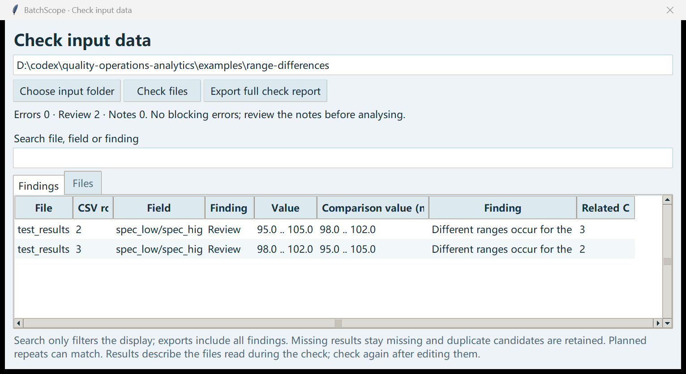

# Check input data / 检查输入数据

Open **Check input data** before running an analysis. Choose the folder containing the four documented CSV files and `SOURCE.json`, then click **Check files**.

For a small range-comparison example, choose `examples/range-differences` from the extracted download. It gives two review prompts and no errors. Both assay results are inside their own ranges; the prompt asks you to review the differing ranges.

The **Files** tab shows how many records could be read. **Findings** lists the file, row, field, value and reason. Double-click a finding to read its full text. Search narrows the display; **Export full check report** always saves every finding, along with file hashes and English/Chinese HTML reports.

- **Error:** fix this before analysing. Examples include a missing file, bad date, repeated ID, unmatched parent record or different result/specification units.
- **Review:** matching measurement content under different IDs. This might be duplicate entry or a planned repeat. Both records remain in the analysis; decide what they mean before using counts.
- **Review:** different ranges for the same product, test, method and unit, including across batches. Each affected record shows another range and its row. Neither range is treated as approved. Check the applicable version; the app has no specification version history. Different methods or units are compared separately.
- **Note:** a measurement is blank. It stays missing, never zero.

Numbers accept a decimal point, optional sign and scientific notation, such as `98.5`, `-1` or `1e2`. Commas, underscores, units, formulas and non-finite values are rejected. The app does not guess the intended value or convert units.

Results and limits are compared as exact decimals without rounding. CSV and JSON retain numeric text; SQLite uses TEXT with DECIMAL_ORDER collation. Counts and percentages remain summary measures. Numeric input is limited to 1024 characters; non-finite values and non-zero values outside the previous floating-point storage range are still rejected.

The check covers the input files, including records after the chosen analysis date. Row numbers count CSV records, with the header as row 1; a malformed CSV instead reports the parser's line. If syntax or value errors prevent reliable relationships, fix them and check again to see remaining relationship checks.

Each check captures the files once. Analysis repeats the same check and uses those captured bytes for its database and recorded hashes. This binds a run to its inputs; it does not lock the original files. Recheck after editing. Separate checks and analyses can reflect different versions of a file.

This prototype accepts only folders marked as synthetic. Passing a check means the implemented rules found no blocking errors; it does not prove that the measurements or specifications are correct.

## 中文

先打开 **检查输入数据**，选择数据文件夹，再点 **开始检查**。文件夹应包含数据字典中的四个 CSV 和 `SOURCE.json`。

想试范围核对，可以选择解压文件夹里的 `examples/range-differences`。预期会出现 2 条“需核对”、0 个错误。两条含量结果均在各自范围内，提示针对的是范围不同。

**文件概况**显示可读取的记录数；**问题清单**列出文件、行号、字段、原值和原因，双击可看全文。搜索只改变显示，**导出完整检查报告**仍会保存全部问题、文件校验值和中英文报告。

- **错误**：先修正，再分析。例如缺文件、日期无效、编号重复、找不到关联记录，或检验值与范围的单位不一致。
- **需核对**：编号不同，检验内容却相同。可能是重复录入，也可能是计划内复检。程序保留两条记录，使用统计数量前需要核对。
- **需核对**：同一产品、检验项目、方法和单位下出现不同范围，包括不同批次。每条受影响记录会列出另一条范围及行号。对照值不代表批准值，需要核对适用版本；程序没有规格版本历史。不同方法或单位分开比较。
- **提示**：检验值为空。继续保留为空，不补零。

数值可以写成 `98.5`、`-1`、`1e2`。逗号、下划线、单位文字、公式和无穷值会被拦住，程序不会猜数值，也不换算单位。

检验值和上下限按输入的十进制数比较，不先舍入。CSV 和 JSON 保留数字文本；SQLite 使用 TEXT 和 DECIMAL_ORDER 排序规则。数量与百分比仍是统计指标。数值最长 1024 个字符；超出原有有限数范围或小到会转成零的非零数仍被拦住。

预检检查整个输入文件，包括分析截止日期之后的记录。行号按 CSV 记录计数，表头为第 1 行；CSV 解析失败时显示解析器的行号。若格式或数值错误影响关联检查，先修正后重查。

一次检查读取一份文件快照。运行分析时会重新检查，并用同一份快照建立数据库、记录校验值。它不会锁住原文件；改过文件后需要重新检查。预检和分析是两次操作，可能读到不同版本。

本程序仅接受标记为模拟数据的文件夹。通过检查只说明现有规则没发现阻止分析的问题，不代表检验值或范围一定正确。
