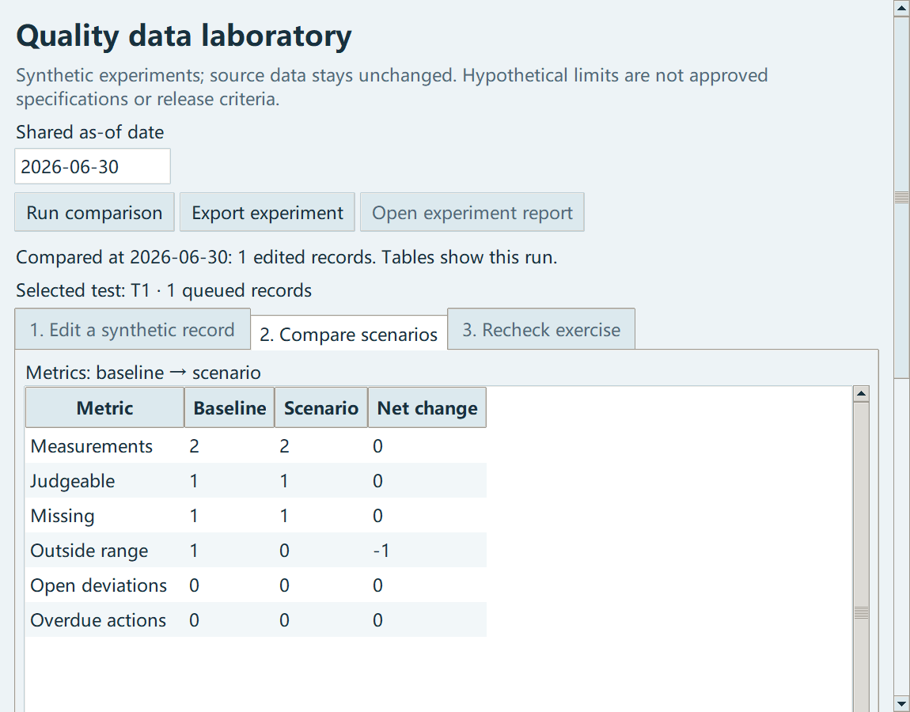
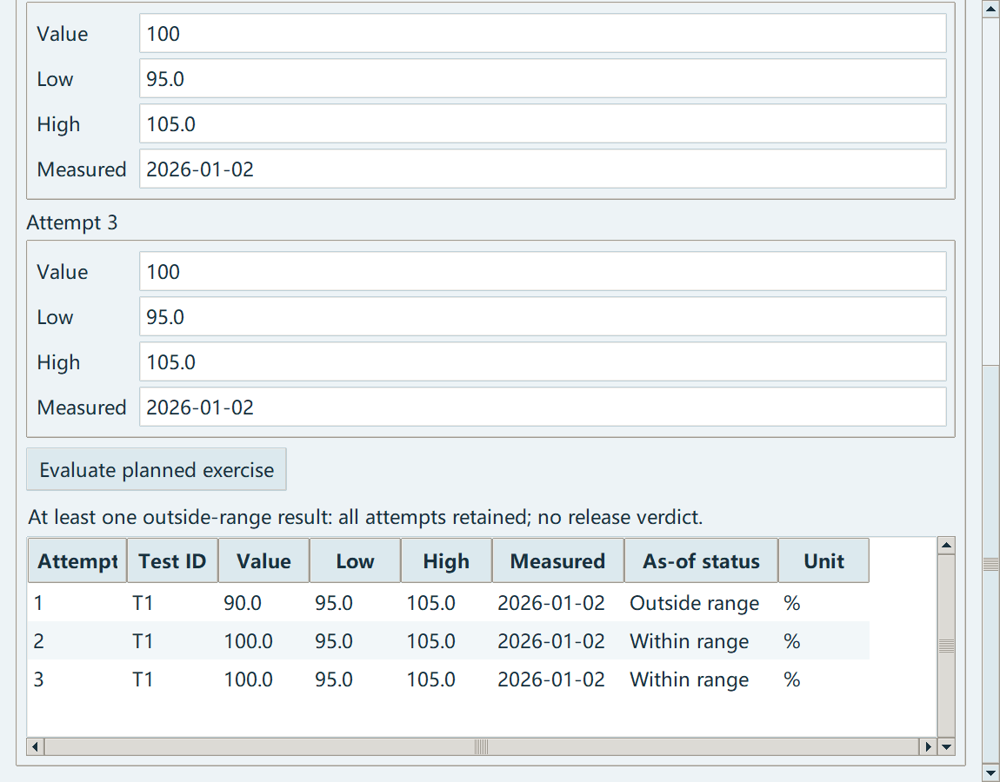

# Quality data laboratory / 质量数据实验室

Change a synthetic result, its fictional bounds or measurement date and compare the outcome. Both scenarios use the same as-of date. The laboratory copies a completed analysis snapshot; it never edits the original CSVs, database or main-window results.

修改模拟检验值、示例范围或检验日期，观察结果如何变化。两种情景共用一个截至日期。实验室从已完成分析复制快照，不改原始 CSV、数据库或主界面结果。



## Try an experiment / 做一次实验

1. Generate demo inputs and run the main analysis. Open **Quality data laboratory**. / 生成模拟数据并完成主分析，打开「质量数据实验室」。
2. Search for a test or batch. Select its row and edit the result, bounds or date. A blank result means missing; zero is a measured value. / 搜索检验或批次，选中一行后修改。空白表示缺失，零是实际模拟数值。
3. Choose **Stage / update change**. You can stage several records before running. **Restore selected** removes that record's queued edits. / 点击「加入 / 更新修改」，可累计多条修改；「恢复选中记录」移除该记录的修改。
4. Set the shared as-of date and **Run comparison**. Read the baseline, scenario and change counts, then scroll to the record-level settings. / 设置共用截至日期并运行，查看原始、假设及净变化，再查看记录级修改。
5. **Export experiment** saves the last current calculation. Changing staged settings or the date disables export until you run again. / 导出保存当前计算；修改已加入的设置或日期后需重新运行，不能把旧结果当新结果导出。

Changes in counts need context. Moving a measurement beyond the as-of date removes it from that date's denominator; it does not demonstrate better quality. Changing a bound is a hypothetical exercise, never an approved specification change. Tests outside a range do not automatically create deviations or actions.

数量变化需要结合条件阅读。把检验日期移到截至日期之后，会减少当日统计记录，不代表质量改善；修改范围仅是假设，不是批准规格。超范围不会自动生成偏差或措施。

## Two- and three-attempt practice / 二次、三次检验练习

Select a test in the editing tab, then open **Recheck exercise**. The original result, bounds and date are shown before you enter the plan. Choose two or three total attempts, provide a reason, then enter all additional results, bounds and dates before evaluating.

先在编辑页选中检验，再进入「重复检验练习」。界面先显示保留的初始结果及范围、日期；选择总轮次、填写练习理由，录入后续各轮条件，再统一评价。

- Attempt 1 always keeps the source result. Later within-range results never erase it. / 第 1 轮始终保留原始结果，后续范围内结果不能抹去它。
- Dates cannot go backwards. Teaching ranges may stay equal or narrow; widening is rejected in this exercise. Narrower is not automatically more accurate. / 日期不能倒退；练习范围可保持或收窄，不能放宽。收窄不等于更准确。
- Every attempt is shown separately. No average, majority vote, final-pass score or batch-release verdict is produced. / 每轮单独显示，不取平均、不多数投票、不生成最终合格分数或批次放行结论。
- Repeat exercises are separate from scenario metrics. They do not insert new measurements into the main database. / 重复练习与情景指标分开，不向主数据库插入新检验。



This is a teaching exercise, not a real OOS investigation, approved retest plan, validated LIMS or laboratory procedure. FDA's OOS guidance rejects repeatedly testing until a passing result appears and disregarding an initial OOS result without scientific justification. Follow the applicable approved procedures and responsible quality review for real work. [FDA OOS guidance, May 2022](https://www.fda.gov/media/158416/download).

这是教学练习，不是真实 OOS 调查、获批复检计划、经验证的 LIMS 或实验室规程。上述 FDA 指导不支持反复检到合格后、在无科学依据时忽略原始超规格结果。实际工作应使用适用的批准程序及质量审核。

## Export and replay / 导出与重跑

The export contains `EXPERIMENT.json`, metrics and record-change CSVs, Chinese/English HTML reports, and separate `baseline/` and `scenario/` input folders. Repeat exercises, if present, include all attempts and their recorded plans. The completion manifest is written last and records file hashes. An interrupted export without that manifest is incomplete. Hashes identify bytes; they do not authenticate a reviewer or certify regulatory compliance.

导出包含实验 JSON、指标与记录变化 CSV、中英文 HTML，以及原始 / 假设两份输入。重复练习保留各轮结果及计划。完成清单最后写入，记录文件哈希；缺少完成清单的中断导出不完整。哈希只标识文件内容，不认证人员或证明合规。

```powershell
python quality_ops.py analyse <experiment>/baseline <new-baseline-output> --as-of 2026-06-30
python quality_ops.py analyse <experiment>/scenario <new-scenario-output> --as-of 2026-06-30
```

Use the as-of date stored in `EXPERIMENT.json` and new output folders. **Reset entire experiment** clears queued edits and practice results; it does not delete exports or source files. / 使用实验 JSON 中的截至日期及新的输出目录。「清空实验」清除排队修改和练习结果，不删除已导出文件或原始数据。
