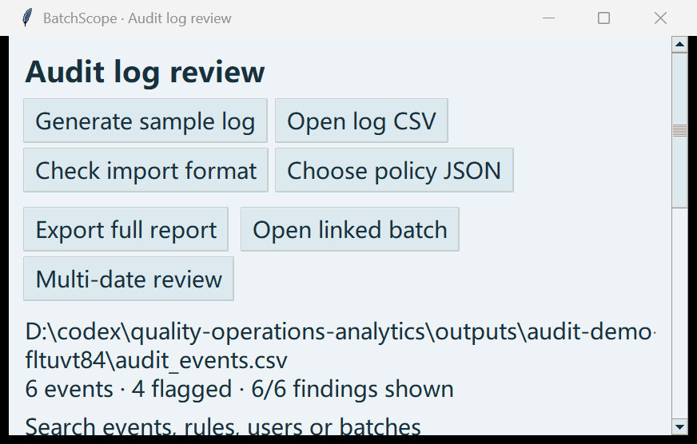
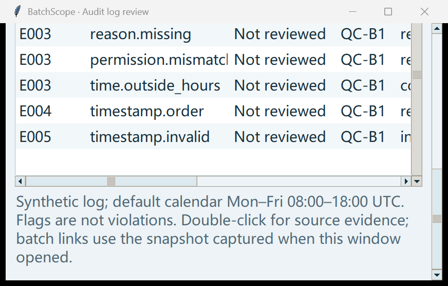

# QC workflow checks / QC 流程检查

An AI-operated test of the desktop controls using fictional data found four workflow problems in v0.7.0-alpha.3. The same tasks were repeated after the fixes. This is software testing, not feedback from an independent QC professional.

使用虚构数据操作桌面控件，在 v0.7.0-alpha.3 中复现四处问题；修复后重做了相同任务。这是 AI 执行的软件测试，不是真实质检员的独立反馈。

| Task / 操作 | Before / 之前 | After / 修复后 |
|---|---|---|
| Switch records / 切换记录 | Unstaged `101.25` disappeared. / 未加入队列的输入丢失。 | The draft remains with its record; hidden drafts also block export. / 按记录保留草稿，其他记录的草稿也计入导出检查。 |
| Edit a repeat / 修改复检 | `110` on the form could export the earlier `100` without a pending notice. / 表单改动后仍可直接导出旧评价。 | Export is blocked until evaluation; close asks about pending edits. / 重新评价前不能导出，关闭会提示未处理的输入。 |
| Enter a missing parent ID / 关联编号输错 | Finding showed `parent_id` and a blank value. / 提示字段不实际、原值为空。 | Shows `deviation_id`, `QC-NOT-FOUND` and `deviations.csv`. / 显示真实列名、编号和目标表。 |
| Use a small audit window / 缩小审计窗口 | Buttons and evidence were clipped at `850 × 500`, font 14. / 按钮和记录被挤出。 | Actions wrap; the table and notes can be reached by scrolling. Tested in both languages. / 按钮换行，列表和说明可滚动到达，中英文均有测试。 |

126 source tests passed locally. The follow-up walkthrough contains 13 observations, including a known floating-point precision limit. Original input files and the baseline database stayed unchanged. Tests cover all repeat fields, record switching, failed evaluation, edits arriving during a worker job, and export history. See the [observations](validation/qc-workflow-20261016.json) and [GUI regressions](../test_qc_workflow_ui.py).

本地 126 项测试通过。跟踪试用记录 13 项观察，其中包含一项已知的浮点精度限制。原始输入和基线数据库未改变；新增测试涵盖每个复检字段、切换记录、评价失败、计算期间出现改动，以及导出历史。

Very close decimal boundaries can still round to the same binary floating-point value, for example `94.999999999999999` and `95`. This release protects draft workflows; it does not change numeric precision or establish suitability for real batch release. Drafts are held only while the laboratory window remains open.

极接近边界的小数仍可能舍入为同一个浮点数，例如 `94.999999999999999` 与 `95`。本轮修复草稿流程，没有改变数值精度，也不证明适合真实批次放行。草稿仅保留在打开的实验室窗口中。
