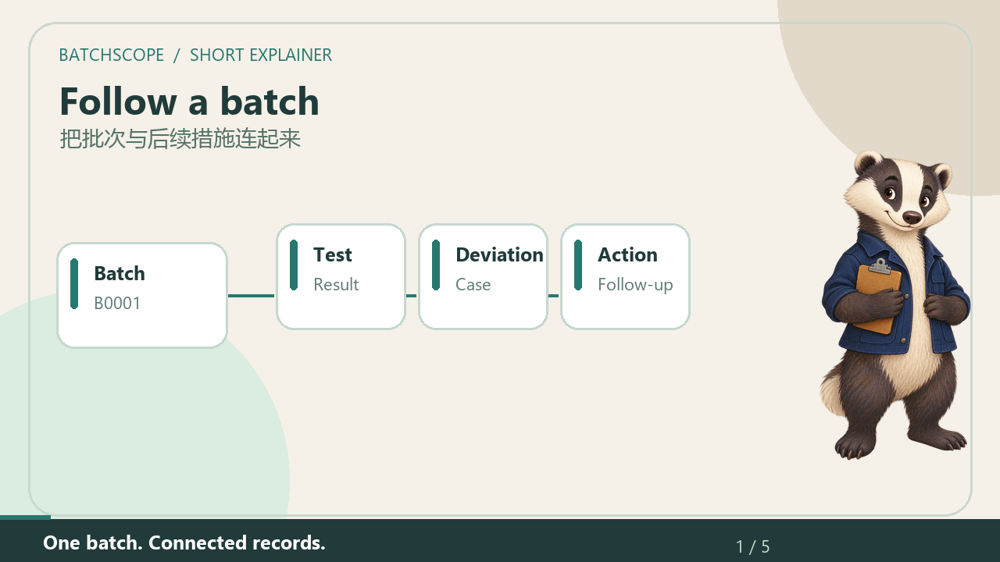

# BatchScope videos / BatchScope 视频

## New 40-second introduction / 新版 40 秒短动画

[Watch the badger explain BatchScope / 看小獾讲解](demo/mascot/BatchScope-Mascot-Short-v0.6.0-alpha.5.mp4) · [English subtitles](demo/mascot/English.srt) · [中文字幕](demo/mascot/Chinese.srt)

The picture-book scenes explain a fictional batch and audit event, then show a current capture of the desktop app. The badger and moving cards are illustrations, not app features. The English voice is locally synthesised. Flags are prompts for review, not compliance verdicts. / 绘本画面讲模拟批次与审计事件，穿插当前软件截图。小獾和卡片只是讲解动画；英文旁白为本机合成。标记是复核线索，不是合规结论。

## Earlier 78-second version / 旧版 78 秒动画

[Watch or download MP4 / 观看或下载](https://github.com/rayexzh/batchscope/releases/download/v0.6.0-alpha.1/BatchScope-Short-Explainer.mp4) · [Video, voice and subtitles / 视频、旁白与字幕包](https://github.com/rayexzh/batchscope/releases/download/v0.6.0-alpha.1/BatchScope-Short-Demo-Pack.zip)

Moving record cards, an audit-event example, a four-date chart, and the real desktop interface explain the workflow. English narration with English captions and Chinese chapter text. / 使用移动记录卡片、审计事件、四日期曲线及真实软件画面讲解流程，配英文旁白、英文字幕和中文章节说明。

Version **v0.6.0-alpha.1**, 78 seconds, 1280×720, 20 fps, H.264/AAC MP4. All numbers come from the fixed-seed fictional example. The June–July overdue change is 30 + 4 − 1 = 33. / 全部数值来自固定种子模拟数据，6 至 7 月逾期变化为 30＋4－1＝33。

This is an illustrated explainer, not a continuous screen recording. Screenshots are captured from the native desktop app; the event-detail card is a labelled illustration. Microsoft Zira Desktop provides locally synthesized English narration, not the maintainer's voice. No real-company data or user endorsement is presented. / 这是动画讲解而非连续录屏。截图来自桌面软件，事件卡片明确标为示意；英文旁白由本机合成，不是作者录音，不含真实企业数据或用户背书。

[Script](demo/SHORT_SCRIPT.md) · [Capture script](../tools/capture_short_demo.py) · [Animation source](../tools/render_short_demo.py)

Media generation requires Pillow and imageio-ffmpeg in a build environment; the application itself still uses the standard library. Run the capture script first, then the rendering script on Windows. Full video decoding is checked after encoding; representative encoded frames are visually inspected. Timing in the supplied SRT follows the illustrated chapters. / 媒体制作依赖仅用于构建环境。先捕获软件画面，再运行动画脚本；编码后检查完整解码并查看代表帧。字幕时间按动画章节安排。
